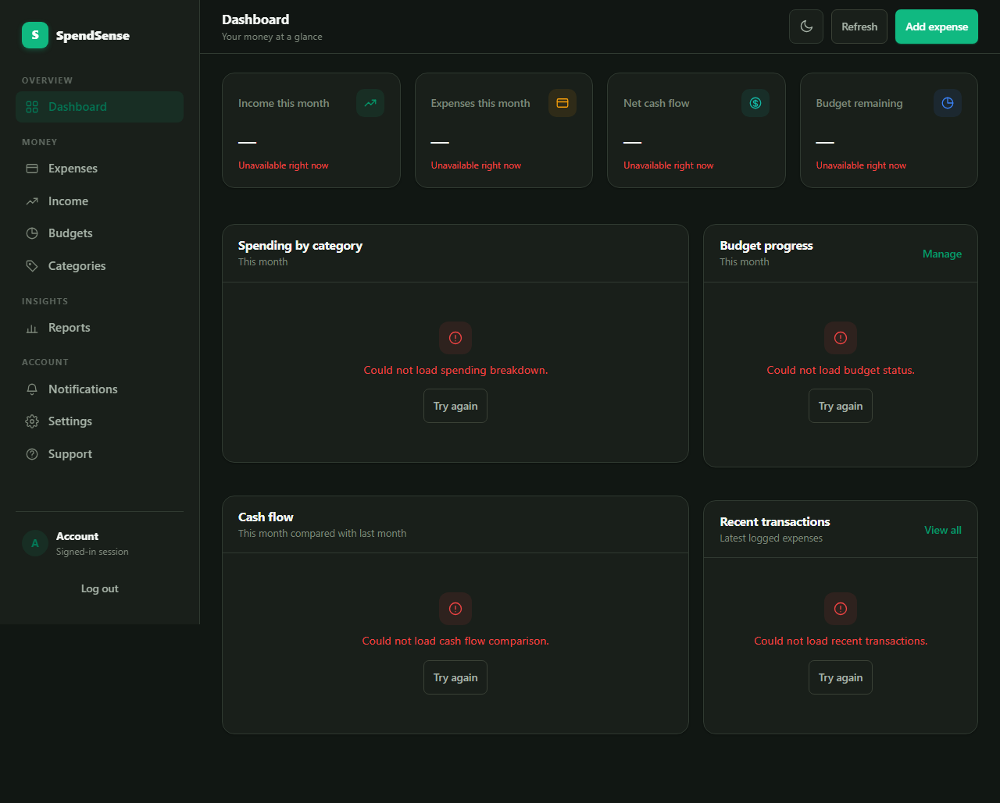
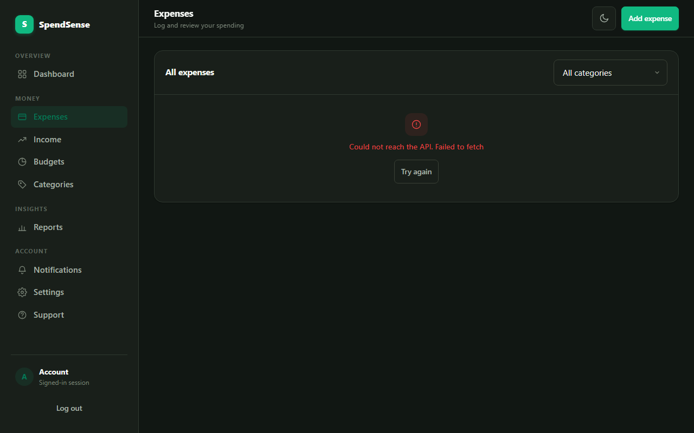
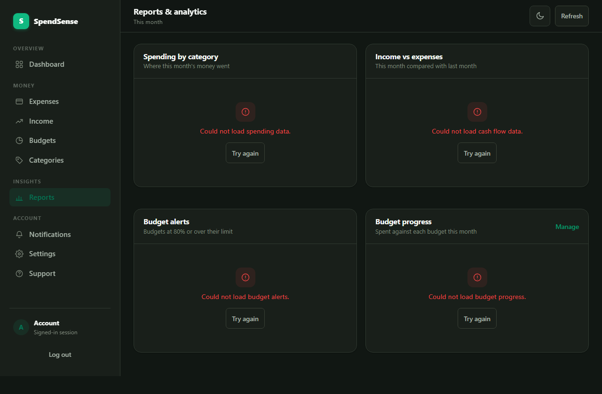
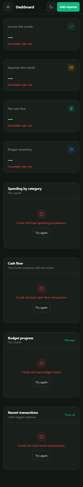
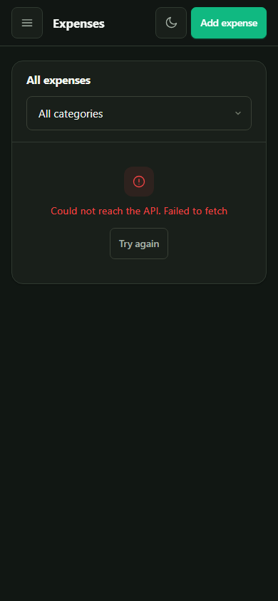
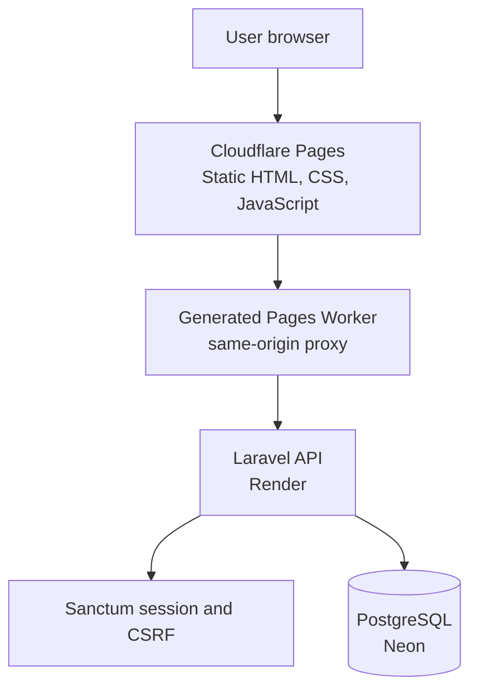

# SpendSense — Frontend

The browser-based interface for **SpendSense**, a personal-finance application that brings income, expenses, budgets, and reports into one responsive workspace.

<p>
  <a href="https://spendsensehq.pages.dev"></a>
  <a href="https://github.com/ThunderSkull7/spendsense-frontend/actions/workflows/ci.yml"></a>
  <a href="CHANGELOG.md"></a>
  <a href="LICENSE"></a>
  
  
  
  
</p>

> This repository contains the frontend. The Laravel API is maintained separately in [spendsense-backend](https://github.com/ThunderSkull7/spendsense-backend).

## Project links

| Resource | Link |
|---|---|
| Live application | https://spendsensehq.pages.dev |
| Backend repository | [ThunderSkull7/spendsense-backend](https://github.com/ThunderSkull7/spendsense-backend) |
| Frontend repository | [ThunderSkull7/spendsense-frontend](https://github.com/ThunderSkull7/spendsense-frontend) |
| Architecture guide | [docs/ARCHITECTURE.md](docs/ARCHITECTURE.md) |
| Development guide | [docs/DEVELOPMENT.md](docs/DEVELOPMENT.md) |
| Deployment guide | [docs/DEPLOYMENT.md](docs/DEPLOYMENT.md) |
| Release & versioning | [docs/RELEASES.md](docs/RELEASES.md) |
| Changelog | [CHANGELOG.md](CHANGELOG.md) |
| Contributor guide | [CONTRIBUTING.md](CONTRIBUTING.md) |
| Security policy | [SECURITY.md](SECURITY.md) |
| Code of conduct | [CODE_OF_CONDUCT.md](CODE_OF_CONDUCT.md) |
| Issues and feature requests | [GitHub Issues](https://github.com/ThunderSkull7/spendsense-frontend/issues) |

## Visual showcase

The SpendSense interface provides a calm, responsive personal finance workspace designed for both desktop and mobile viewports.

### Desktop experience

#### Financial dashboard


*The dashboard brings monthly cash flow, category-level spending progress, and recent transactions into a single view with Indian Rupee (₹ INR) currency formatting and customizable layout widgets.*

#### Expense management & tracking


*A clean ledger interface for filtering, searching, and reviewing categorized expenses with soft-delete safety, trash/restore operations, and pagination.*

#### Financial reports & period analytics


*Detailed financial analytics providing month-over-month comparisons, budget status tracking, spending trends, and streaming CSV exports.*

---

### Mobile responsiveness

SpendSense is fully responsive across tablet and mobile form factors, featuring touch-optimized navigation, collapsible sidebars, and adaptive financial cards.

| Mobile dashboard | Mobile transaction management |
|:---:|:---:|
|  |  |
| **Mobile dashboard**<br>Touch-friendly cards with instant monthly cash-flow and budget status | **Mobile transactions**<br>Streamlined expense ledger optimized for single-hand mobile interaction |

## Features

The current frontend source contains the following application areas:

| Area | What it provides |
|---|---|
| Landing and authentication | Entry page, login, signup, and password-recovery screens |
| Dashboard | Financial overview and dashboard preferences |
| Expense management | Expense history and expense entry |
| Income management | Income records and recurring-income related UI |
| Budget planning | Budget management and progress |
| Categories | Expense and income category management |
| Reports and analytics | Reporting views and period-based analysis |
| Notifications | In-app notification interface |
| Settings | Account and application preferences |
| Support | Help and support page |

The checked-in HTML page set includes 14 pages. Feature behavior and available actions are implemented across the corresponding JavaScript modules and should be evaluated in the running application.

## Design and interaction

- Responsive layouts are implemented in the shared styles and page-specific stylesheets.
- The shared theme module supports light and dark modes and four accent palettes: Green, Blue, Red, and Amber (corresponding to values `green`, `blue`, `red`, and `amber`).
- Currency and date formatting are centralized in the shared settings module.
- Shared API and transaction client modules keep common browser interactions consistent.

## Architecture

The frontend is a static, multi-page HTML/CSS/JavaScript application. It communicates with a separately deployed Laravel API.



### Same-origin API proxy

The deployment preparation script `deploy/prepare-frontend-deploy.js` creates a deployable copy of the static site and generates a Cloudflare Pages `_worker.js` proxy.

The Worker forwards only the explicitly allowed API paths (including `/api/*`, `/sanctum/*`, and the exact `/user` path) to the backend. Other paths are served as static assets. This keeps browser requests on the Pages origin and supports the first-party cookie and CSRF flow used by Sanctum.

The generated deployment copy is distinct from the source tree: the preparation script rewrites the configured development API origin in the copy and verifies that the source files remain unchanged.

## Technology

| Area | Technology |
|---|---|
| Markup | HTML5 |
| Styling | CSS |
| Browser logic | Vanilla JavaScript |
| Shared settings | `theme.js` |
| Node-side test tooling | Node.js built-in test runner |
| Hosting | Cloudflare Pages |
| API | Laravel 12 backend |
| Authentication | Laravel Sanctum session cookies and CSRF |

The application source does not require a frontend package manifest for its browser runtime. Node.js is used by the repository's tests and deployment tooling.

## Getting started

### Prerequisites

- A modern web browser
- A local PHP/Laravel backend from [spendsense-backend](https://github.com/ThunderSkull7/spendsense-backend)
- Node.js for tests and deployment preparation
- A local static HTTP server

### 1. Clone the repository

```bash
git clone https://github.com/ThunderSkull7/spendsense-frontend.git
cd spendsense-frontend
```

### 2. Start the backend

Follow the backend repository's setup instructions. By default, the frontend HTML uses the local API base URL `http://127.0.0.1:8002`.

### 3. Serve the frontend

Start any standard static HTTP server from the repository root:

- **Using Node `npx serve`:**
  ```bash
  npx serve -l 8000 .
  ```
- **Using Python 3:**
  ```bash
  python -m http.server 8000
  ```

Open `http://127.0.0.1:8000` in your browser. Ensure the backend's Sanctum stateful-domain and CORS configuration includes the local frontend origin used by your development setup.

### 4. Run frontend tests

SpendSense uses the native Node.js test runner orchestrated via `tools/run-tests.js`:

```bash
# Run Node unit, orchestration, and Worker proxy tests
node tools/run-tests.js --suite=node

# Run headless Chrome browser regression tests
node tools/run-tests.js --suite=browser

# Run the complete test suite (all test files sequentially)
node tools/run-tests.js --suite=all

# Verify site structure
node tools/legacy-site-verify.js
```

### 5. Prepare a production deployment copy

The deployment helper validates the production Pages origin, copies the static application, generates the Worker proxy, and rewrites the development API origin in the destination copy.

```bash
node deploy/prepare-frontend-deploy.js --api-base-url https://spendsensehq.pages.dev --destination ./dist-deploy
```

Review the generated directory before deploying. Do not put credentials or secrets in frontend source files; anything shipped to the browser is public.

## Repository structure

```text
.
├── authentication/       # Login, signup, password recovery
├── budget-planning/      # Budget interface
├── categories-management/# Category interface
├── dashboard/            # Dashboard
├── expense-management/   # Expense views
├── income-management/    # Income views
├── notifications/        # Notification interface
├── reports-analytics/    # Reports and analytics
├── settings/              # User preferences
├── support/               # Support page
├── tests/                 # Node and browser regression tests
├── tools/                 # Static site verification
├── deploy/                # Deployment preparation and safety checks
├── docs/                  # Documentation and screenshot assets
├── theme.js               # Shared theme/currency/date behavior
├── transactions-client.js # Shared transaction client logic
└── styles.css             # Shared styles
```

## CI and deployment pipeline

GitHub Actions workflows are maintained under `.github/workflows/ci.yml`. On every push and pull request to `main`, the CI pipeline executes:
1. **JavaScript Syntax Verification:** Validates ES module syntax across all modules.
2. **Node Unit & Worker Tests:** Runs automated test discovery covering API client retries, date conversions, theme tokens, and Pages Worker routing.
3. **Headless Chrome Browser Tests:** Launches headless Chrome via Chrome DevTools Protocol to assert layout responsiveness and interaction integrity.
4. **Deploy Preparation Verification:** Verifies `deploy/prepare-frontend-deploy.js` creates deployable builds with production origin rewrites while preserving source files.

Check the [Actions tab](https://github.com/ThunderSkull7/spendsense-frontend/actions) for real-time status.

## Contributing

Contributions and technical feedback are welcome! Please review our [Contributing Guide](CONTRIBUTING.md), [Security Policy](SECURITY.md), and [Code of Conduct](CODE_OF_CONDUCT.md) before submitting pull requests or opening issues.

## License

Distributed under the MIT License. See [LICENSE](LICENSE).
