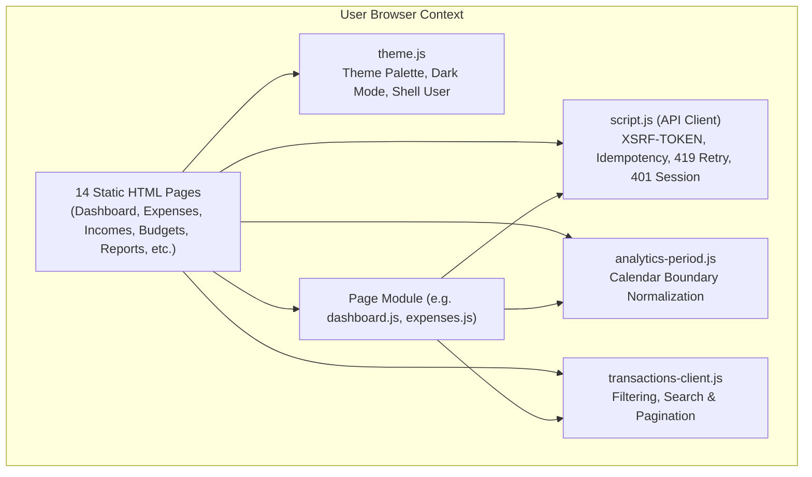
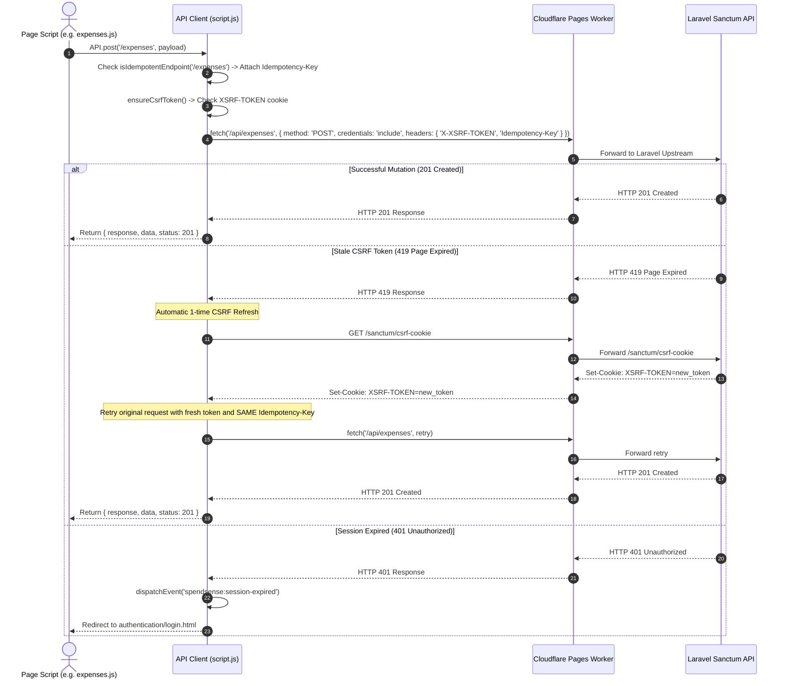
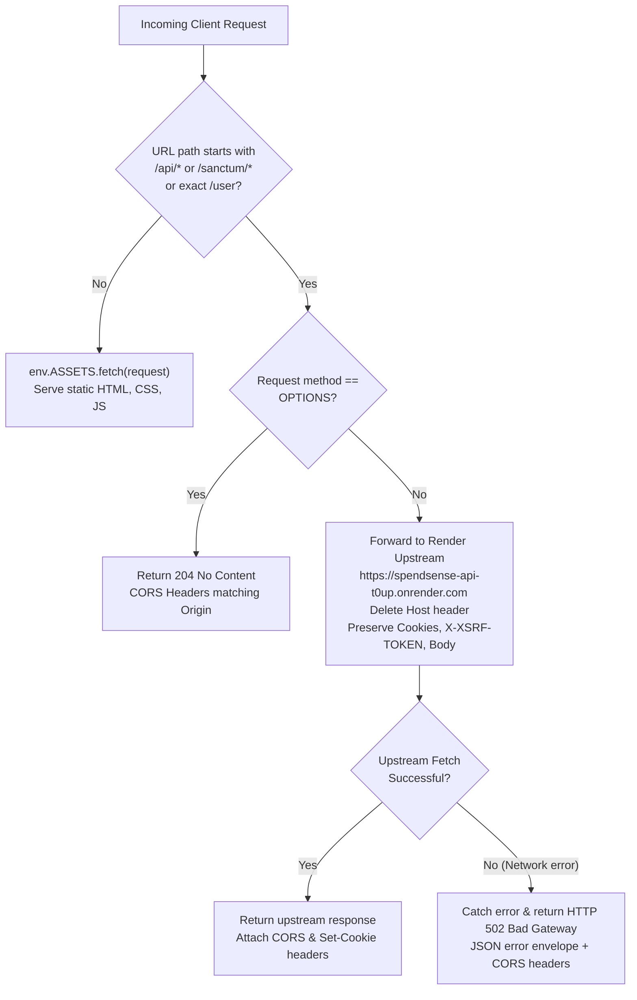

# SpendSense Frontend — Architecture & Design

This document details the architecture, script hierarchy, module boundaries, theme engine, and same-origin reverse proxy infrastructure of the SpendSense frontend application.

---

## 1. System Overview & Multi-Page Architecture

SpendSense is built as a responsive, zero-dependency **Multi-Page Application (MPA)** using semantic HTML5, modern CSS3 variables, and vanilla JavaScript (ES2022+). Rather than relying on a heavy Single-Page Application (SPA) framework, each functional domain is served as an independent HTML page.

### Architectural Principles

1. **Zero Runtime Framework Overhead:** No virtual DOM, client-side bundler runtime, or hydration delay. Pages render natively with minimal Time-To-Interactive (TTI).
2. **Domain Isolation:** Each application section resides in its own directory with dedicated HTML, CSS, and JS files (e.g. `expense-management/`, `budget-planning/`, `reports-analytics/`).
3. **Shared Foundation:** Common utilities (theming, session handling, API client, date formatting, and transaction table filtering) are modularized in the root directory and shared across all pages.
4. **First-Party Security:** Relies on HTTP-only session cookies and CSRF tokens bridged through a same-origin Cloudflare Pages reverse proxy.

---

## 2. Shared JavaScript Modules

| Module | Location | Purpose & Primary Responsibilities |
| :--- | :--- | :--- |
| **`theme.js`** | Root | Executed synchronously in `<head>` to prevent Flash of Unstyled Content (FOUC). Applies color palettes (`green`, `blue`, `red`, `amber`), toggles dark/light mode, replaces hardcoded currency symbols, and hydrates user identity (`.user-name`, `.user-email`). Safe storage fallback to memory if `localStorage` is blocked. |
| **`script.js`** | Root | Core HTTP communication layer. Configures API origin from `<meta name="api-base-url">`, manages Sanctum CSRF cookies (`fetchXSRFToken`), attaches UUIDv4 idempotency keys, transparently retries 419 token mismatches, and emits `spendsense:session-expired` on 401s. |
| **`analytics-period.js`** | Root | Synchronizes analytics and reporting boundaries (`start_date`, `end_date`, calendar month selectors) so the dashboard and reports pages query identical calendar intervals. |
| **`transactions-client.js`**| Root | Client-side filtering, case-insensitive substring searching, multi-column sorting, and boundary-inclusive date filtering for transaction ledgers. |

---

## 3. API Client & Authentication Handling (`script.js`)

The `API` singleton in `script.js` governs all backend network communication:

---

## 4. Cloudflare Pages & Worker Reverse Proxy (`_worker.js`)

Browsers reject cross-origin cookies under modern privacy defaults (`SameSite=Lax`, cross-site tracking prevention). If the frontend on `https://spendsensehq.pages.dev` communicated directly with `https://spendsense-api-t0up.onrender.com`, session cookies would fail.

### Worker Proxy Routing Logic

When deployed to Cloudflare Pages, `deploy/prepare-frontend-deploy.js` outputs a generated `_worker.js` that acts as a same-origin bridge:

### Origin Validation
The Worker inspects the incoming `Origin` header:
- Production host: `https://spendsensehq.pages.dev` (allowed).
- Cloudflare Pages preview subdomains: `https://*.spendsensehq.pages.dev` (allowed).
- Localhost development: `http://localhost:*`, `http://127.0.0.1:*` (allowed).
- Unauthorized origins: Defaults strictly to `https://spendsensehq.pages.dev` to prevent cross-origin abuse.

---

## 5. Theme & State Management (`theme.js`)

- **Storage:** Persisted in `localStorage` under `spendsenseThemeColor`, `spendsenseThemeMode`, and `spendsenseCurrency`.
- **Fault-Tolerance:** If `localStorage` access is restricted (e.g. private browsing mode or iframe sandboxing), `theme.js` intercepts the error and seamlessly falls back to an in-memory `Map`.
- **Accents:** Exactly 4 palettes supported:
  - `green` (Emerald default: `#10B981`)
  - `blue` (Indigo: `#6366F1`)
  - `red` (Rose: `#FB7185`)
  - `amber` (Gold: `#F59E0B`)
- **Dark Mode:** Toggles `data-mode="dark"` on `document.documentElement`, altering CSS semantic tokens (`--bg`, `--surface`, `--text-primary`, `--border`).
- **Dynamic Currency Formatting:** A `TreeWalker` automatically traverses static text nodes upon page load, replacing hardcoded currency amounts with the user's selected symbol (₹ INR, $ USD, € EUR, £ GBP, etc.).
