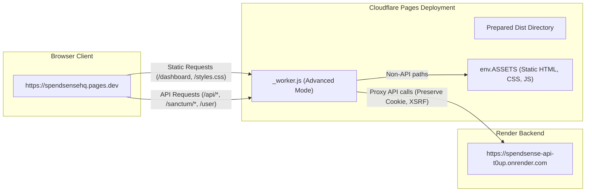

# SpendSense Frontend — Deployment Guide

This document explains the production build preparation, Cloudflare Pages integration, same-origin Worker reverse proxy generation, and automated GitHub Actions deployment pipeline.

---

## 1. Deployment Architecture

The SpendSense frontend is hosted as an advanced Cloudflare Pages project. Rather than serving purely static files, a Cloudflare Pages Worker (`_worker.js`) is bundled into the distribution directory, enabling seamless same-origin API proxying.



---

## 2. Deployment Preparation Script (`deploy/prepare-frontend-deploy.js`)

Before files are published to Cloudflare Pages, `deploy/prepare-frontend-deploy.js` creates an isolated, sanitized copy of the frontend:

### Core Responsibilities

1. **API Base URL Rewriting:**
   - Replaces the local development URL (`http://127.0.0.1:8002`) with the production Pages origin (`https://spendsensehq.pages.dev`) in all 14 HTML `<meta name="api-base-url">` tags.
   - **Crucial Invariant:** Rewriting occurs **only** in the destination build folder. The source repository files remain completely untouched with the development URL preserved.
2. **Reverse Proxy Generation (`_worker.js`):**
   - Synthesizes the Cloudflare Worker module directly in the root of the destination directory.
   - Forwards `/api/*`, `/sanctum/*`, and `/user` to `https://spendsense-api-t0up.onrender.com`.
   - Delegates all other paths to `env.ASSETS.fetch(request)`.
   - Attaches same-origin CORS headers (`Access-Control-Allow-Origin`, `Access-Control-Allow-Credentials: true`, `Vary: Origin`).
   - Implements 502 Bad Gateway fallback handling if the upstream Render API is unreachable.
3. **Artifact Sanitization & Exclusions:**
   - Excludes non-public repository assets from the deployed package:
     - `.git/` and `.github/`
     - `deploy/` and `tools/`
     - `tests/`
     - Temporary build artifacts (`dist/`, `build/`, `scratch/`)
   - Guarantees no developer machine paths (e.g. `USERPROFILE`) or sensitive values are committed into distribution HTML/JS files.

### Manual Verification Command
To verify build preparation locally without deploying:
```bash
node deploy/prepare-frontend-deploy.js \
  --api-base-url https://spendsensehq.pages.dev \
  --destination ./dist-verify \
  --force
```

---

## 3. GitHub Actions Continuous Deployment Workflow

Production deployment is managed via `.github/workflows/ci.yml`.

### Deployment Safety & Gates

- **Test Gating:** The `deploy-frontend` job strictly depends on `needs: frontend-tests`. If any unit, integration, browser regression, or build verification test fails, deployment is aborted.
- **Branch Restriction:** Deployments are executed **only** on:
  - Direct pushes to `refs/heads/main` (e.g. merged pull requests).
  - Manual trigger via `workflow_dispatch` on `main`.
  - Pull requests to `main` execute the complete test suite but never trigger deployment.
- **Isolated Concurrency:** The deployment job is constrained by `concurrency: group: frontend-production-deploy, cancel-in-progress: false` to prevent overlapping or out-of-order deploys.

### Required GitHub Secrets

The following GitHub repository secrets must be configured for production publishing:

| Secret Name | Purpose |
| :--- | :--- |
| `API_BASE_URL` | The production browser-facing origin (`https://spendsensehq.pages.dev`). |
| `CLOUDFLARE_API_TOKEN` | Scoped Cloudflare API token with `Cloudflare Pages: Edit` permissions. |
| `CLOUDFLARE_ACCOUNT_ID` | Cloudflare account identifier hosting the `spendsensehq` Pages project. |

*Note: Never expose the values of these secrets in repository code, documentation, or commit messages.*

### Cloudflare Wrangler Step
Deployments use the official `cloudflare/wrangler-action@v4`:
```yaml
- name: Deploy to Cloudflare Pages
  uses: cloudflare/wrangler-action@v4
  with:
    apiToken: ${{ secrets.CLOUDFLARE_API_TOKEN }}
    accountId: ${{ secrets.CLOUDFLARE_ACCOUNT_ID }}
    command: pages deploy ${{ runner.temp }}/spendsense-dist --project-name=spendsensehq --branch=main
```

---

## 4. Rollback & Disaster Recovery

Cloudflare Pages provides instant atomic versioning for every deployment:
1. **Instant Rollback via Dashboard:** In the Cloudflare Dashboard under **Workers & Pages > spendsensehq > Deployments**, select any previous successful deployment and click **Rollback to this deployment**.
2. **Git Rollback:** Reverting the commit on `main` automatically triggers the CI workflow, runs the automated test suites, prepares a clean distribution, and redeploys the previous stable state via Cloudflare Pages once CI verification passes.

