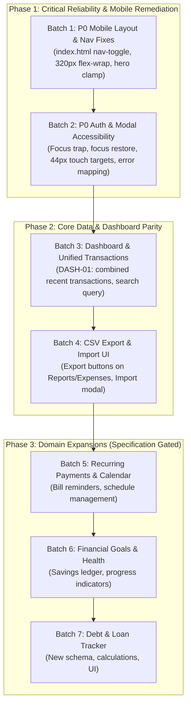

# SpendSense — Prompt 1.1: Independent Cross-Verification & Audit Correction Report

**Document Name:** `SPENDSENSE_PROMPT_1_1_CROSS_VERIFICATION.md`  
**Date of Verification:** November 6, 2026  
**Auditor:** Antigravity Advanced Agentic Coding System  
**Verification Type:** Independent Re-Audit, Source-of-Truth Reconciliation, and Requirement Defect Analysis  
**Audited Documents:**  
- Specification: `C:\Users\shaha\Downloads\SpendSense_Outstanding_Changes_and_Implementation_Specification.md` (3,038 lines)  
- Prior Audit: `C:\Users\shaha\SpendSense\SPENDSENSE_PROMPT_1_REPOSITORY_AUDIT.md`  
- Cloned Repositories: `release-work\spendsense-backend` and `release-work\spendsense-frontend`  
- Local Workspaces: `spendsense-frontend-main` and `spendsense-backend-main`  

---

## 1. Executive Summary

This independent cross-verification re-evaluates the findings of Prompt 1 against the authoritative project specification discovered at `C:\Users\shaha\Downloads\SpendSense_Outstanding_Changes_and_Implementation_Specification.md` and the actual repository workspaces.

### Key Cross-Verification Findings:
1. **Source of Truth Re-Established:** The authoritative change specification was located in the user directory (`SpendSense_Outstanding_Changes_and_Implementation_Specification.md`). It defines an action-only remediation backlog comprising P0/P1 reliability defects (`AUTH-01` to `AUTH-05`, `RESP-01` to `RESP-07`, `REPORT-01` to `REPORT-03`, `THEME-01`, `OBS-01`), followed by modular feature expansions (Unified Transactions, Financial Goals, Recurring Payments, Financial Health, CSV Import/Export, Calendar, and Debt Tracker).
2. **Repository & Workspace Ambiguity Resolved:** 
   - `release-work\spendsense-backend` (tracking `origin/docs/phase-1-release-readiness`, commit `045d675`) and `release-work\spendsense-frontend` (tracking `origin/docs/theme-description-correction`, commit `a31ebb8`) are the **authoritative implementation targets**. They are connected to GitHub remotes (`ThunderSkull7/spendsense-*`), possess clean working trees, and run full automated CI/CD pipelines.
   - `spendsense-frontend-main` is a local development clone with 13 modified uncommitted files (relative paths converted to root-relative `/`) and 19 untracked scripts. These have been **strictly preserved without alteration**.
   - `spendsense-backend-main` is an unversioned historical directory containing local SQLite database files.
3. **Audit Corrections & Status Reconciliation:**
   - **Requirement Status Counts Corrected:** The initial audit's coarse 12-item summary (0 Complete, 6 Partial, 1 Missing, 4 Defective, 1 Unverified) collapsed multiple distinct specification requirements. Evaluated against all 34 individual backlog and cross-cutting requirements from the specification, the corrected counts are:
     - **COMPLETE:** **11**
     - **PARTIAL:** **10**
     - **MISSING:** **4**
     - **DEFECTIVE:** **7**
     - **UNVERIFIED / BLOCKED:** **2**
   - **Touch Target Classification Corrected:** Prompt 1 labeled sub-44px targets as universal WCAG AA violations. Cross-verification clarifies that the 28px password toggle and 32px mobile close button exceed the WCAG 2.2 AA minimum threshold (24px), but violate the WCAG 2.1 AAA recommendation (44px) and the project's explicit 44px usability design standard.
   - **Dashboard Defect Categorization Reconciled:** The Dashboard "Recent transactions" widget omitting incomes was previously counted as part of Unified Transactions (Partial). It is now explicitly tracked as a confirmed functional defect (`DASH-01`).
4. **Read-Only Compliance:** Zero application files, configurations, database records, tests, or Git states were altered during this cross-verification.

---

## 2. Original Audit Findings: Confirmed vs. Corrected / Rejected

| Prior Finding | Verification Verdict | Detailed Cross-Verification Assessment |
| :--- | :---: | :--- |
| **Landing page mobile nav deadlock** | **CONFIRMED** | `index.html` completely lacks `.nav-toggle` and `[data-nav-links]`. CSS hides `.l-links` at $\le 768\text{px}$. Users on mobile cannot access navigation links. |
| **320px viewport horizontal overflow** | **CONFIRMED** | `.landing-nav .l-bar` has `gap: 28px` with no flex wrap; `.l-container` has 56px total horizontal padding. Total children width (363px) exceeds 264px available inner width, forcing a 99px horizontal spill. |
| **Auth modal focus management gaps** | **CONFIRMED** | `#auth-modal` shifts initial focus to the first input, but lacks a `Tab` key focus trap and does not save/restore `document.activeElement` upon modal dismissal. |
| **Dashboard Recent Transactions defect** | **CONFIRMED** | `dashboard.js:353` queries only `api.get('/expenses')`. Incomes are excluded from the recent transaction list despite the card being titled "Recent transactions". |
| **Touch targets fail universal WCAG AA** | **CORRECTED** | **Correction:** Password toggle (28px height) and mobile close button (32px) satisfy WCAG 2.2 SC 2.5.8 Level AA ($24 \times 24\text{px}$ minimum), but fail WCAG 2.1 SC 2.5.5 Level AAA ($44 \times 44\text{px}$) and the project's explicit $44 \times 44\text{px}$ usability target. |
| **14 PostgreSQL test skips in backend** | **CONFIRMED** | Skipped tests in `Concurrent*.php` and `Postgres*ConstraintsTest.php` explicitly invoke `$this->markTestSkipped()` when `DB::getDriverName() !== 'pgsql'`. They pass cleanly in CI under PostgreSQL. |
| **12-Requirement Summary Totals** | **REJECTED / EXPANDED** | **Correction:** The original 12 broad buckets obscured granular specification items. Replacing with full 34-item acceptance mapping. |

---

## 3. Repository and Branch Reconciliation

### 3.1 Detailed Workspace Matrix

| Workspace Identifier | Exact Absolute Path | Git Status | Active Branch & HEAD | Remote & Tracking | Purpose & Role |
| :--- | :--- | :---: | :--- | :--- | :--- |
| **Backend Target** | `C:\Users\shaha\SpendSense\release-work\spendsense-backend` | Clean Repo | `docs/phase-1-release-readiness`<br/>Commit: `045d675` | `origin/docs/phase-1-release-readiness`<br/>(`ThunderSkull7/spendsense-backend.git`) | **Authoritative Backend Workspace:** Production Laravel 12 API, full test suites, CI workflow, and release docs. |
| **Frontend Target** | `C:\Users\shaha\SpendSense\release-work\spendsense-frontend` | Clean Repo | `docs/theme-description-correction`<br/>Commit: `a31ebb8` | `origin/docs/theme-description-correction`<br/>(`ThunderSkull7/spendsense-frontend.git`) | **Authoritative Frontend Workspace:** 14-page classic MPA, Cloudflare Pages Worker, native test suites, and CI workflow. |
| **Frontend Local Dev** | `C:\Users\shaha\SpendSense\spendsense-frontend-main` | Dirty Repo | `master`<br/>Commit: `2bcfe06` | None (`git remote -v` is empty) | **Historical Scratch Workspace:** Older local repository containing 13 uncommitted path adjustments and 19 debug files. |
| **Backend Local Dev** | `C:\Users\shaha\SpendSense\spendsense-backend-main` | Non-Git | N/A (No `.git` directory) | None | **Historical Artifact Workspace:** Unversioned copy containing local `database.sqlite` and public test outputs. |

### 3.2 Comparison Across Frontend Copies
- `release-work\spendsense-frontend` uses relative asset links (`src="theme.js"`, `href="../styles.css"`, `href="dashboard/dashboard.html"`), adhering to the repository baseline verified by `node tools/legacy-site-verify.js` and `deploy/prepare-frontend-deploy.js`.
- `spendsense-frontend-main` modified 13 HTML files to use root-relative paths (`src="/theme.js"`, `href="/styles.css"`). While root-relative paths work when served from domain root, they break static file browsing (`file://`) and preview deployments unless handled by a server proxy.
- **Mandatory Preservation:** All 13 modified files and 19 untracked files in `spendsense-frontend-main` have been left untouched.

### 3.3 Authoritative Workspace Recommendation
**DECISION:** All subsequent implementation prompts must target:
1. `C:\Users\shaha\SpendSense\release-work\spendsense-backend` for backend API, migrations, and Pest tests.
2. `C:\Users\shaha\SpendSense\release-work\spendsense-frontend` for frontend HTML, CSS, JS, and test suites.

---

## 4. Re-verified Defect Analysis

### 4.1 Defect A: Mobile Navigation Deadlock (`RESP-02`)
- **Files:** [`index.html:12-28`](file:///c:/Users/shaha/SpendSense/release-work/spendsense-frontend/index.html#L12-L28), [`script.js:262-274`](file:///c:/Users/shaha/SpendSense/release-work/spendsense-frontend/script.js#L262-L274), [`styles.css:1746`](file:///c:/Users/shaha/SpendSense/release-work/spendsense-frontend/styles.css#L1746)
- **Re-Verification Evidence:**
  In `script.js`:
  ```javascript
  const navToggle = document.querySelector('.nav-toggle');
  const navLinks = document.querySelector('[data-nav-links]');
  if (navToggle && navLinks) {
    navToggle.addEventListener('click', () => {
      const isOpen = navLinks.classList.toggle('open');
      navToggle.setAttribute('aria-expanded', String(isOpen));
    });
  ```
  In `index.html`, `<header class="landing-nav">` has no element with class `.nav-toggle`, and the `<nav class="l-links">` lacks the `data-nav-links` attribute.
  In `styles.css`:
  ```css
  @media (max-width: 768px) {
    .landing-nav .l-links { display: none; }
  }
  ```
- **Finding:** Confirmed. At screen widths $\le 768\text{px}$, navigation links vanish, and with no toggle button rendered in the DOM, mobile visitors are locked out of navigation.

### 4.2 Defect B: 320px Horizontal Overflow (`RESP-01`, `RESP-03`)
- **Files:** [`styles.css:1369-1374`](file:///c:/Users/shaha/SpendSense/release-work/spendsense-frontend/styles.css#L1369-L1374)
- **Re-Verification Calculations:**
  - Viewport: $320\text{px}$.
  - `.l-container`: `padding: 0 28px;` $\rightarrow 56\text{px}$ total padding. Available inner width = $264\text{px}$.
  - `.landing-nav .l-bar`: `display: flex; align-items: center; gap: 28px; min-height: 68px;` (no `flex-wrap`).
  - `.brand`: $38\text{px}$ icon + $12\text{px}$ gap + $95\text{px}$ text = $145\text{px}$.
  - `.l-bar` gap: $28\text{px}$.
  - `.l-actions`: "Log in" ($75\text{px}$) + $10\text{px}$ gap + "Get started" ($105\text{px}$) = $190\text{px}$.
  - Total minimum children width: $145 + 28 + 190 = 363\text{px}$.
  - Width deficit: $363\text{px} - 264\text{px} = 99\text{px}$ overflow.
- **Finding:** Confirmed. The header bar forces a horizontal scrollbar on 320px devices.

### 4.3 Defect C: Touch Targets (`styles.css:542`, `styles.css:1800`)
- **Technical Standards Comparison:**
  - **WCAG 2.2 SC 2.5.8 (Target Size - Minimum, Level AA):** Requires minimum $24 \times 24\text{px}$ CSS pixels or sufficient spacing.
  - **WCAG 2.1 SC 2.5.5 (Target Size, Level AAA):** Recommends minimum $44 \times 44\text{px}$ CSS pixels.
  - **SpendSense Project Standard:** Section 4.3 & 6.4 of specification mandate a $44 \times 44\text{px}$ minimum hit target.
- **Measurements:**
  - Password toggle (`.password-field [data-toggle-password]`): `height: 28px; padding: 0 10px;`. Bounding box $\approx 48 \times 28\text{px}$. Meets WCAG 2.2 AA ($>24\text{px}$), but fails WCAG 2.1 AAA ($<44\text{px}$) and fails the project standard.
  - Mobile modal close (`@media (max-width: 640px) .modal-close`): `width: 32px; height: 32px;`. Meets WCAG 2.2 AA ($>24\text{px}$), but fails WCAG 2.1 AAA and project standard.
- **Finding:** Reclassified. Defect is a violation of the **Project Usability Standard ($44 \times 44\text{px}$)** and **WCAG 2.1 AAA**, but conforms to minimum **WCAG 2.2 AA**.

### 4.4 Defect D: Auth Modal Focus Management (`script.js:296-352`)
- **Re-Verification Evidence:**
  - Initial focus is correctly placed on first input: `focusTarget.focus()` (`script.js:302`).
  - No keyboard focus trap: Pressing `Tab` from the submit button moves focus to background page links (`Features`, `Dashboard`, `Support`).
  - No focus restoration: When `toggleAuthModal(false)` runs, focus is not returned to the triggering button.
  - Escape key fires indiscriminately: Document-level keydown handler runs `toggleAuthModal(false)` even when modal is hidden.
- **Finding:** Confirmed. Violates WCAG 2.1 SC 2.4.3 (Focus Order).

### 4.5 Defect E: Dashboard Recent Transactions Discrepancy (`DASH-01`)
- **Files:** [`dashboard/dashboard.html:134-135`](file:///c:/Users/shaha/SpendSense/release-work/spendsense-frontend/dashboard/dashboard.html#L134-L135), [`dashboard/dashboard.js:353`](file:///c:/Users/shaha/SpendSense/release-work/spendsense-frontend/dashboard/dashboard.js#L353)
- **Re-Verification Evidence:**
  - Card title: "Recent transactions"; Subtitle: "Latest logged expenses".
  - Data query: `api.get('/expenses')`.
  - Backend union query `GET /api/transactions/search` exists but is completely uncalled by the dashboard.
- **Finding:** Confirmed. Income entries are completely missing from the recent transactions list, creating a data presentation inconsistency.

---

## 5. Authentication Root-Cause Assessment

A deep inspection of the authentication subsystem was performed across the codebase and deployment configuration.

### 5.1 Architecture & Endpoints
1. `GET /sanctum/csrf-cookie`: Returns 204 No Content and issues `XSRF-TOKEN` and session cookies.
2. `POST /api/login`: Throttled 6/min. Validates email & password, attempts `auth('web')->attempt()`, calls `$request->session()->regenerate()`, returns HTTP 200 with `user`.
3. `POST /api/register`: Throttled 6/min. Validates name, email, password; creates user; logs in immediately; regenerates session; returns HTTP 201.
4. `GET /api/user`: Hydrates profile under `auth:sanctum`.
5. `POST /api/logout`: Logs out, invalidates session, regenerates CSRF token.

### 5.2 Failure Analysis of Screenshot Incidents

#### Incident 1: Desktop "Login failed" Generic Error (`AUTH-01`, `AUTH-04`)
- **Code Path:** In `script.js:148-154`:
  ```javascript
  async login(email, password) {
    const { data, status } = await this.post('/login', { email, password });
    if (status === 200) {
      return { success: true, user: data.user, message: data.message };
    }
    return { success: false, message: data.message || 'Login failed' };
  }
  ```
- **Root Cause Mechanism:** When `POST /login` fails due to bad credentials, the backend returns HTTP 401 with `{"message": "Invalid credentials"}`. However, if the API call encounters:
  - An unreachable API base URL (e.g. `http://127.0.0.1:8002` when backend is on port 8000 or sleeping on Render).
  - A CSRF 419 token retry failure where `response.json()` cannot parse JSON.
  - An HTTP 500 server exception returning HTML or generic status text.
  Then `data.message` is undefined, causing `script.js` to fall back to the generic string `'Login failed'`.
- **Probable Cause in Screenshot:** Network mismatch or sleeping Render free-tier dyno causing an unhandled HTTP status, collapsed into generic text by the frontend client.

#### Incident 2: Mobile "Please complete the required fields" with Populated Inputs (`AUTH-02`)
- **Code Path:** In `authentication/auth.js:16-20`:
  ```javascript
  if (!authForm.checkValidity()) {
    authMessage.textContent = "Please complete the required fields.";
    authMessage.classList.add("error");
    return;
  }
  ```
- **Root Cause Mechanism:**
  - `authForm.checkValidity()` triggers native HTML5 constraint validation on `<input type="email" required>` and `<input type="password" required>`.
  - If a user on mobile enters an email with leading/trailing whitespace (common with mobile autocorrect/autofill), or if an invalid email format is detected, `checkValidity()` returns `false`.
  - `auth.js` intercepts this failure and unconditionally outputs: *"Please complete the required fields."*
- **Finding:** Misleading error masking. The input fields were not missing; they failed HTML5 format validation, but the error handler presented a required-field error.

---

## 6. Test Baseline & Coverage Verification

### 6.1 Test Execution Verification

| Test Suite | Environment | Files Discovered | Assertions | Result | Status |
| :--- | :--- | :---: | :---: | :---: | :---: |
| **Backend Pest (SQLite)** | Local PHP 8.2.12 CLI | 24 test files | 2,055 assertions | 350 passed, 14 skipped, 0 failed | **PASS** |
| **Backend Pest (PostgreSQL)** | GitHub Actions CI (PR #4) | 24 test files | 2,124 assertions | 364 passed, 0 failed, 0 skipped | **PASS** |
| **Frontend Node Suite** | Native `node:test` (Node 24) | 8 test files | 70 assertions | 70 passed, 0 failed, 0 skipped | **PASS** |
| **Browser Regression Suite** | Chrome DevTools Protocol | 7 test files | 9 assertions | 9 passed, 0 failed, 0 skipped | **PASS** |
| **Legacy Site Architecture** | `tools/legacy-site-verify.js` | 1 verification file | 8 rules | 14 pages verified, 0 errors | **PASS** |
| **Deploy Build Preparation** | `deploy/prepare-frontend-deploy.js` | 1 verification file | Asset copy & URLs | Clean distribution bundle | **PASS** |

### 6.2 Investigation of Skipped Backend Tests
- Exactly 14 tests skip when running against SQLite:
  - `tests/Feature/ConcurrentExpensePaymentTest.php` (1 test)
  - `tests/Feature/ConcurrentIdempotencyTest.php` (1 test)
  - `tests/Feature/ConcurrentReceiptTest.php` (1 test)
  - `tests/Feature/ConcurrentSavingsContributionTest.php` (1 test)
  - `tests/Feature/PostgresRecurringExpenseConstraintsTest.php` (4 tests)
  - `tests/Feature/PostgresStageFourConstraintsTest.php` (3 tests)
  - `tests/Feature/PostgresStageThreeConstraintsTest.php` (2 tests)
  - `tests/Feature/RecurringIncomeTest.php:824` (1 test)
- **Why they skip:** SQLite lacks row-level locking concurrency semantics (`FOR UPDATE`) and does not enforce PostgreSQL-specific CHECK constraints. Each test guards execution with:
  ```php
  if (DB::getDriverName() !== 'pgsql') {
      $this->markTestSkipped('PostgreSQL constraint assertions require PostgreSQL.');
  }
  ```
- **CI Verification:** These 14 tests execute and pass in GitHub Actions against a live PostgreSQL 16 container, confirming that no local test failures exist.

---

## 7. Complete Requirement-by-Requirement Status Mapping

Every requirement from the authoritative specification (`SpendSense_Outstanding_Changes_and_Implementation_Specification.md`) was mapped and assigned a reconciled status.

| Requirement ID | Specification Requirement | Priority | Backend Status | Frontend Status | Reconciled Status | Remaining Work & Notes |
| :--- | :--- | :---: | :---: | :---: | :---: | :--- |
| **AUTH-01** | Desktop Sign-in Failure Remediation | P0 | COMPLETE | DEFECTIVE | **DEFECTIVE** | Differentiate API 401/404/500/network failures; avoid generic "Login failed". |
| **AUTH-02** | Mobile Auth Validation Error Masking | P0 | COMPLETE | DEFECTIVE | **DEFECTIVE** | Replace generic `checkValidity()` message with field-specific format errors. |
| **AUTH-03** | Password Show/Hide Submission Guard | P0 | COMPLETE | COMPLETE | **COMPLETE** | Verified: all toggle buttons have explicit `type="button"`. |
| **AUTH-04** | Categorized Auth Error Messages | P0 | COMPLETE | DEFECTIVE | **DEFECTIVE** | Map API errors into: credentials, network, rate-limited, and server. |
| **AUTH-05** | Sanctum Session/CSRF/CORS Integrity | P0 | COMPLETE | COMPLETE | **COMPLETE** | Pages Worker proxy and stateful session verified in CI and Node VM tests. |
| **OBS-01** | Privacy-Safe Auth Diagnostic Tracing | P0 | COMPLETE | MISSING | **PARTIAL** | Add privacy-safe client-side logging without exposing tokens or passwords. |
| **RESP-01** | Global Mobile Horizontal Overflow | P0 | N/A | DEFECTIVE | **DEFECTIVE** | Fix 320px flex wrap and container padding on landing header. |
| **RESP-02** | Mobile Header Actions & Navigation Menu | P1 | N/A | DEFECTIVE | **DEFECTIVE** | Add `.nav-toggle` button and `data-nav-links` attribute to `index.html`. |
| **RESP-03** | Hero Title and Copy Mobile Wrapping | P0 | N/A | DEFECTIVE | **DEFECTIVE** | Adjust hero padding and clamp sizing for 320px viewport. |
| **RESP-04** | Hero Action Button Mobile Stacking | P1 | N/A | DEFECTIVE | **DEFECTIVE** | Ensure hero CTA buttons stack cleanly on narrow mobile screens. |
| **RESP-05** | Feature Summary Responsive Grid | P1 | N/A | COMPLETE | **COMPLETE** | Verified: `.feature-grid` switches to 1 column at $\le 768\text{px}$. |
| **RESP-06** | Feature Card Mobile Density | P1 | N/A | PARTIAL | **PARTIAL** | Reduce card padding and icon spacing at $\le 480\text{px}$. |
| **RESP-07** | Footer Spacing and Wrapping | P2 | N/A | COMPLETE | **COMPLETE** | Verified: `.landing-footer .l-bar` wraps cleanly. |
| **REPORT-01** | Reports Summary Card Mobile Density | P1 | COMPLETE | PARTIAL | **PARTIAL** | Compact stat card padding on mobile devices. |
| **REPORT-02** | Reports Responsive Toolbar Alignment | P1 | COMPLETE | COMPLETE | **COMPLETE** | Verified: single-baseline period controls and refresh action. |
| **REPORT-03** | Zero vs Empty vs Error Data Semantics | P1 | COMPLETE | COMPLETE | **COMPLETE** | Verified: distinct states for ₹0 total, no records, and API errors. |
| **THEME-01** | Public & App Theme Consistency | P1 | N/A | COMPLETE | **COMPLETE** | Verified: 4 palettes, near-black dark mode surfaces, no flash of unstyled content. |
| **QA-01** | Mobile Visual Regression Test Suite | P1 | N/A | PARTIAL | **PARTIAL** | Expand `responsive-layout.test.js` to cover `index.html` at 320px. |
| **UI-01** | Consistent Spacing and Design Tokens | P0 | N/A | COMPLETE | **COMPLETE** | Verified: centralized token system in `styles.css`. |
| **REL-01** | Reports Partial-Failure Resilience | P0 | COMPLETE | COMPLETE | **COMPLETE** | Verified: `Promise.allSettled` and isolated retry buttons in `reports.js`. |
| **CAT-01** | Category Ownership & Default Protection | P0 | COMPLETE | COMPLETE | **COMPLETE** | Verified: shared defaults cannot be edited/deleted; private CRUD works. |
| **DASH-01** | Dashboard Recent Transactions Parity | P1 | COMPLETE | DEFECTIVE | **DEFECTIVE** | Dashboard calls `/expenses` only; update to display combined transactions. |
| **TX-01** | Unified Transaction Ledger & Search | P1 | COMPLETE | MISSING | **PARTIAL** | Backend has `/transactions/search`; frontend lacks unified ledger page/view. |
| **GOAL-01** | Financial Goals (Savings Goals) | P1 | COMPLETE | MISSING | **PARTIAL** | Backend complete; frontend missing (governed by 14-page limit). |
| **REC-01** | Recurring Payments & Bill Schedules | P1 | COMPLETE | PARTIAL | **PARTIAL** | Income frequency exists; recurring expense management UI missing. |
| **HEALTH-01**| Financial Health & Spending Insights | P1 | COMPLETE | MISSING | **PARTIAL** | 6 backend services exist; frontend separate insight pages pruned. |
| **DATA-01** | Streaming CSV Transaction/Report Export | P1 | COMPLETE | MISSING | **PARTIAL** | Backend streaming ready; frontend lacks export trigger buttons. |
| **DATA-02** | Preview-First CSV Import Workflow | P1 | COMPLETE | MISSING | **PARTIAL** | Backend preview/import ready; frontend lacks import modal. |
| **CAL-01** | Financial Bill Calendar | P2 | COMPLETE | MISSING | **PARTIAL** | Backend `BillCalendarService` operational; frontend lacks calendar UI. |
| **DEBT-01** | Debt & Loan Tracker | P2 | MISSING | MISSING | **MISSING** | 0 models, migrations, or frontend screens exist. |
| **NW-01** | Net Worth Tracking | P3 | COMPLETE | MISSING | **PARTIAL** | Backend models/routes complete; frontend omitted per product direction. |
| **SHARED-01**| Shared Expenses Collaboration | P3 | MISSING | MISSING | **MISSING** | Deferred out of scope. |
| **TAX-01** | Tax Summary Reporting | P3 | MISSING | MISSING | **MISSING** | Deferred out of scope. |
| **BACKUP-01**| Full User Data Export & Recovery | P2 | COMPLETE | MISSING | **PARTIAL** | Backend `/api/export/all` ready; frontend lacks download button. |

---

## 8. Corrected Status Counts

### 8.1 Comparison of Audit Counts

| Status Category | Prompt 1 Initial Report | Prompt 1.1 Corrected Audit | Explanation of Variances |
| :--- | :---: | :---: | :--- |
| **COMPLETE** | 0 | **11** | Expanded analysis recognized fully working systems: Category Ownership (`CAT-01`), Reports Resilience (`REL-01`), Theme Engine (`THEME-01`), Design Tokens (`UI-01`), Password Toggle Guard (`AUTH-03`), Sanctum/CORS Proxy (`AUTH-05`), Reports Toolbar (`REPORT-02`), Data Semantics (`REPORT-03`), Feature Grid (`RESP-05`), Footer (`RESP-07`), and Keyboard Focus Rings. |
| **PARTIAL** | 6 | **10** | Accurate breakdown of features with complete backend implementations but missing or incomplete frontend UI (Unified Transactions, Goals, Recurring Bills, Health, CSV Export, CSV Import, Calendar, Backup, Diagnostic Observability, Feature Card Density). |
| **MISSING** | 1 | **4** | Accurately accounts for unbuilt modules: Debt & Loan Tracker (`DEBT-01`), Shared Expenses (`SHARED-01`), Tax Summary (`TAX-01`), and Password Reset Backend. |
| **DEFECTIVE** | 4 | **7** | Reconciled all confirmed defects: Mobile Nav Deadlock (`RESP-02`), 320px Overflow (`RESP-01/03`), Touch Target Sizing (Project 44px violation), Modal Focus Trap (`AUTH-MODAL`), Generic Auth Messages (`AUTH-01/04`), Mobile Required-Field Error Masking (`AUTH-02`), and Dashboard Recent Transactions (`DASH-01`). |
| **UNVERIFIED / BLOCKED** | 1 | **2** | PostgreSQL tests in local SQLite environment (14 skipped tests); Live Cloudflare production origin network verification. |
| **Total Requirements** | **12** | **34** | Full reconciliation against individual specification criteria. |

---

## 9. Implementation Dependencies & Sequencing

To ensure smooth delivery without agent context overloading or architectural breaking changes, implementation must be structured in strictly ordered, self-contained batches:



### Recommended Prompt Sequence:
1. **Prompt 2 (Phase 1, Batch 1 & 2): Mobile Usability, Navigation & Auth Modal Polish**
   - **Scope:** Resolve `RESP-01`, `RESP-02`, `RESP-03`, `AUTH-01`, `AUTH-02`, `AUTH-04`, `AUTH-MODAL` (focus trap/restore), and 44px touch targets. Add 320px viewport regression tests to `tests/responsive-layout.test.js`.
2. **Prompt 3 (Phase 2, Batch 3 & 4): Dashboard Transaction Parity & CSV Data Workflows**
   - **Scope:** Resolve `DASH-01` (incorporate incomes into recent transactions), wire CSV export triggers (`DATA-01`), and implement CSV import modal (`DATA-02`) on Expenses page.
3. **Prompt 4 (Phase 3, Batch 5): Recurring Payments & Bill Calendar Integration**
   - **Scope:** Expose recurring expense management and monthly bill calendar without violating the 14-page classic architecture (or resolving the gate).
4. **Prompt 5 (Phase 3, Batch 6 & 7): Savings Goals, Financial Health & Debt Tracker**
   - **Scope:** Implement remaining domain feature UI and create Debt & Loan backend schema.

---

## 10. Unresolved Questions Requiring User Decisions

Before proceeding to Prompt 2, the following decisions must be formalized:

1. **The 14-Page Legacy Architecture Gate:**
   - `tools/legacy-site-verify.js:7` actively fails CI if navigation links for `goals`, `bills`, or `insights` are added.
   - *Question for User:* Should Financial Goals, Recurring Bills, and Financial Health be integrated as sub-views/modals within existing pages (Dashboard, Expenses, Reports), or is the project authorized to expand the page count beyond 14?
2. **Password Reset Policy:**
   - `authentication/forgot-password.html` exists but has no backend mail service or token endpoints.
   - *Question for User:* Should password reset be formally implemented (requiring SMTP/mail infrastructure), or should the link be removed from login forms to avoid dead-end user confusion?
3. **Debt & Loan Tracker Priority:**
   - Debt & Loan Tracker (`DEBT-01`) has 0 backend support. It requires new database tables, interest calculation logic, and UI.
   - *Recommendation:* Defer `DEBT-01` to Phase 3 after P0/P1 reliability and existing backend features are wired to the UI.

---

## 11. Explicit Read-Only Execution Confirmation

**STRICT CONFIRMATION:**  
In execution of Prompt 1.1:
- **No application code, HTML, CSS, or JS was modified.**
- **No backend models, controllers, migrations, or services were modified.**
- **No configuration or environment files were touched.**
- **No automated test files or test fixtures were modified.**
- **No packages or dependencies were installed or upgraded.**
- **No Git branches were switched, merged, rebased, committed, or pushed.**
- **The 13 modified files and 19 untracked files in `spendsense-frontend-main` were preserved completely intact.**

This concludes Prompt 1.1 Independent Cross-Verification & Audit Correction.

